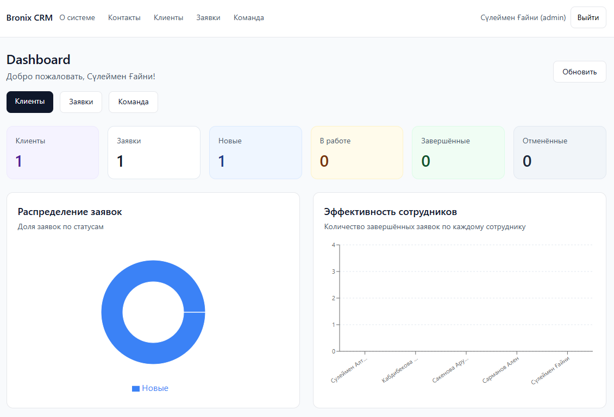
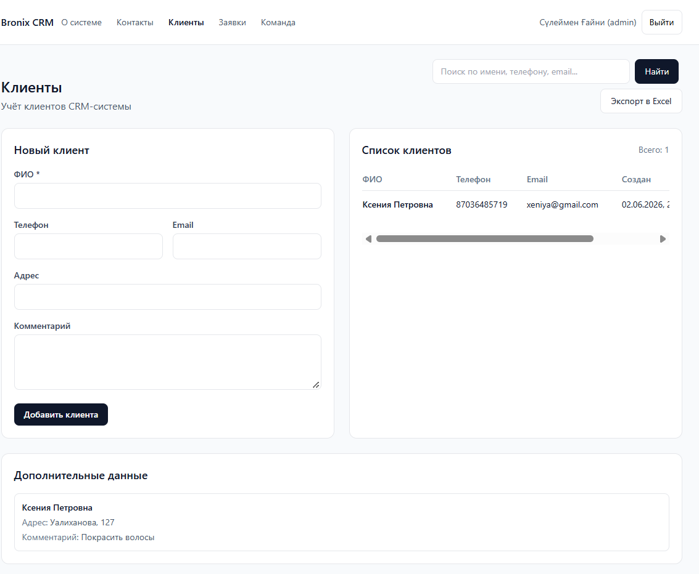
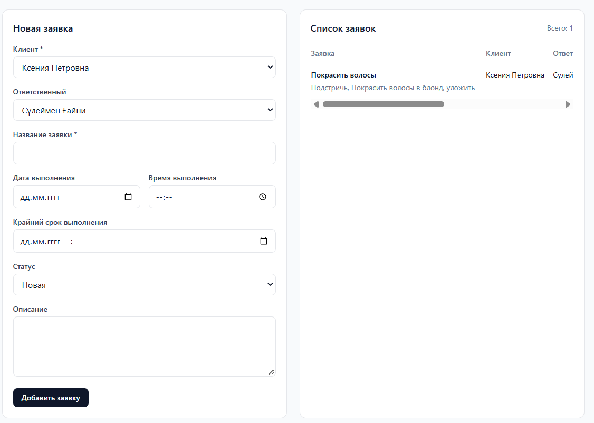
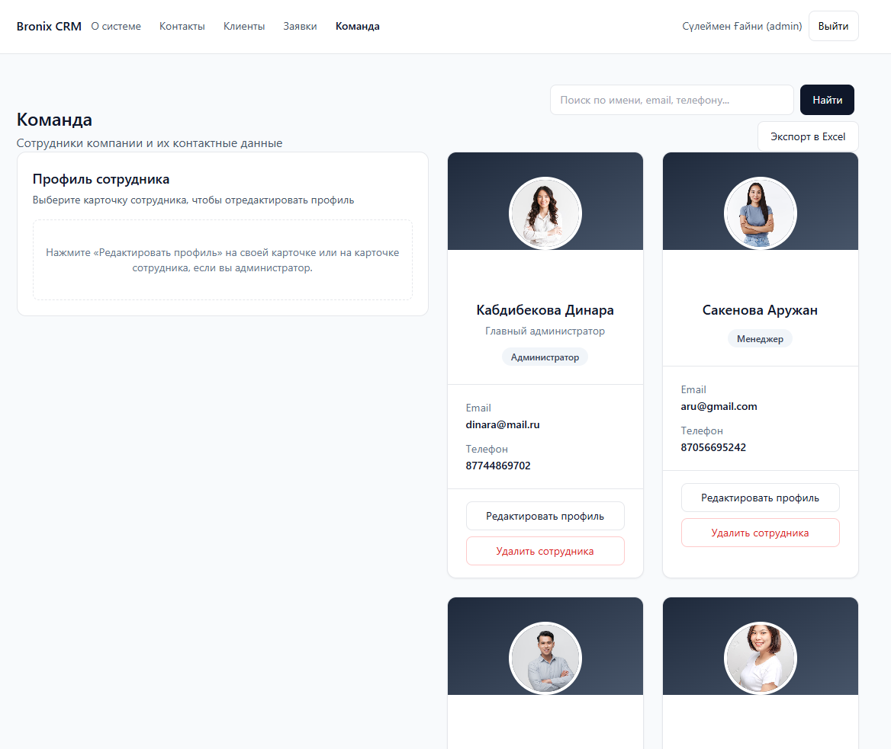

# Bronix CRM

A full-stack Customer Relationship Management (CRM) web application designed to streamline client management, service requests, and team workflows. Built with a clean, responsive interface and real-time analytics.

## Key Features

- **Analytics Dashboard:** Real-time overview of total clients, request statuses (*New*, *In Progress*, *Completed*, *Canceled*), status distribution charts, and employee performance metrics.
- **Client Management:** Full CRUD operations for client records, instant search by name, phone, or email, detailed notes/addresses, and **one-click Excel export**.
- **Request & Task Tracking:** Assign service requests to specific team members, set execution dates and deadlines, manage statuses, and track descriptions.
- **Team & Role-Based Access:** Role-based permissions (`Admin` / `Manager`), interactive employee profile cards with avatars, profile editing, and team directory search/export.
- **Secure Authentication:** JWT-based user authentication and protected API routes.

## Tech Stack

- **Frontend:** React, TypeScript, Vite, Tailwind CSS, React Router, Axios
- **Backend:** Python, FastAPI, SQLAlchemy, Pydantic, JWT Authentication
- **Database:** PostgreSQL

## Interface Preview

### Analytics Dashboard


### Client Management & Excel Export


### Service Requests & Deadlines


### Team & Role Management


## Project Structure

```text
bronix-crm/
├── backend/
│   ├── app/
│   │   ├── api/        # REST API endpoints
│   │   ├── core/       # Config & JWT security
│   │   ├── db/         # Database session & base setup
│   │   ├── models/     # SQLAlchemy ORM models
│   │   └── schemas/    # Pydantic validation schemas
│   ├── main.py         # FastAPI entry point
│   └── requirements.txt
├── frontend/
│   ├── src/
│   │   ├── api/        # Axios API client
│   │   └── routes/     # Application pages & protected routes
│   ├── package.json
│   └── vite.config.ts
└── screenshots/        # UI preview images


Local Setup
Database: Create a PostgreSQL database (e.g., crm_diplom) and configure backend/.env based on backend/.env.example.

Backend:

Bash
cd backend
python -m venv .venv
.venv\Scripts\activate
pip install -r requirements.txt
uvicorn app.main:app --reload
Frontend:

Bash
cd frontend
npm install
npm run dev